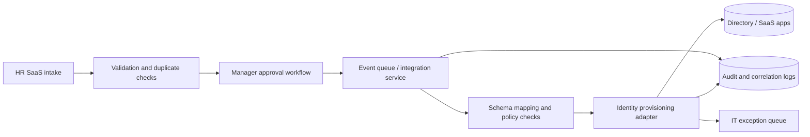

# Proposed integration architecture

## Integration patterns
- **Synchronous:** validate fields and provide immediate errors to HR.
- **Asynchronous:** process approved provisioning through durable queue with retry/dead-letter behavior.
- **Idempotency:** use `onboardingRequestId` to deduplicate repeated requests.
- **Observability:** attach `correlationId` and stage timestamps to all events.
- **Security:** scoped machine identity, encrypted transport, redacted logging, least-privilege roles.

## Boundary note
This is an architecture proposal. JSONPlaceholder GET/POST calls are isolated mock exercises and are **not connected** to HR, manager approval, or IAM systems.
