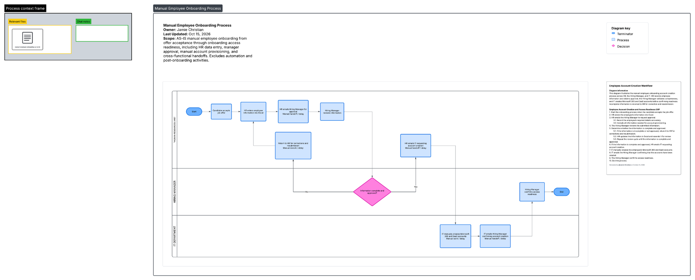
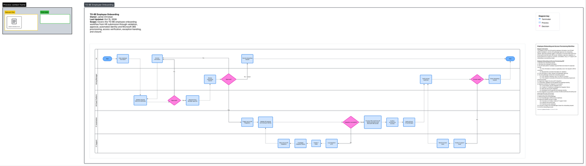
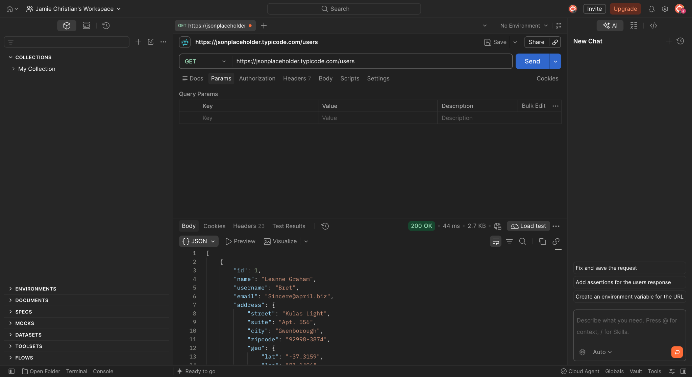
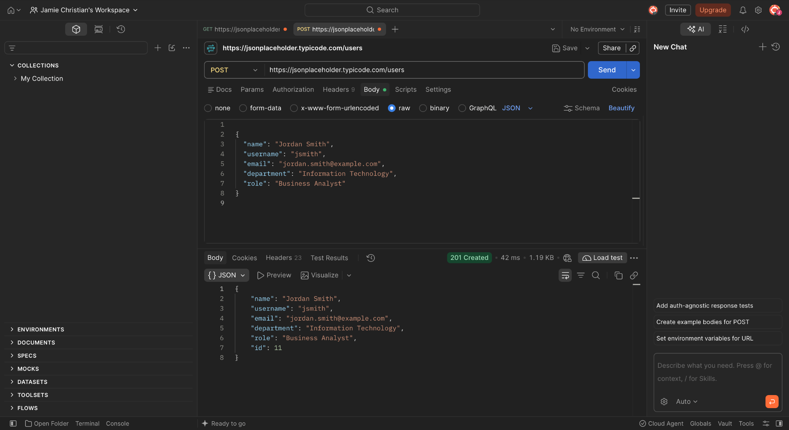
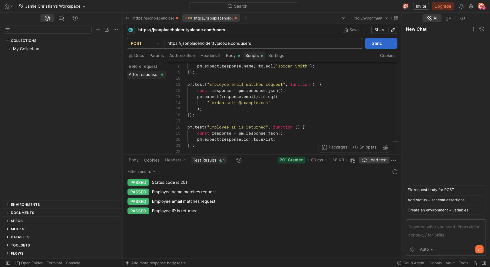
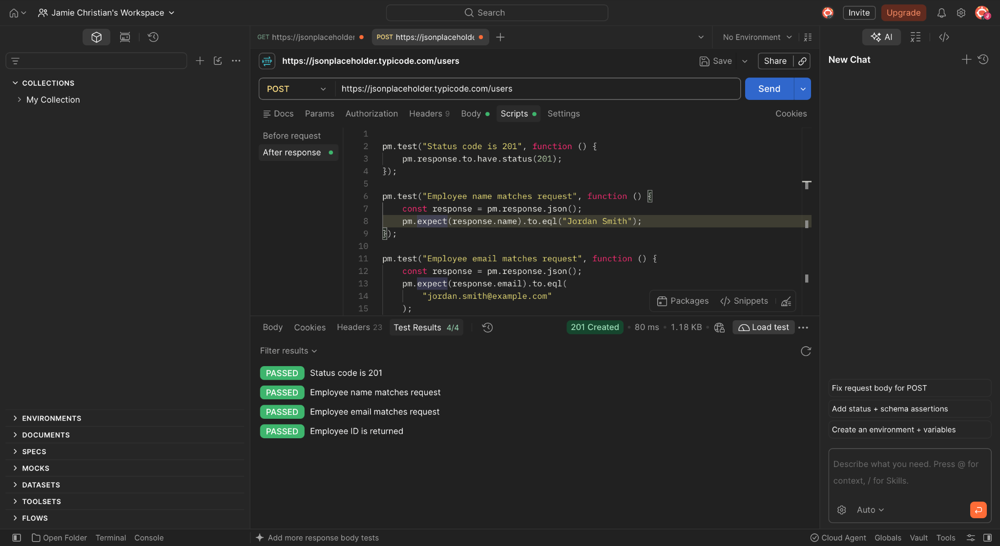
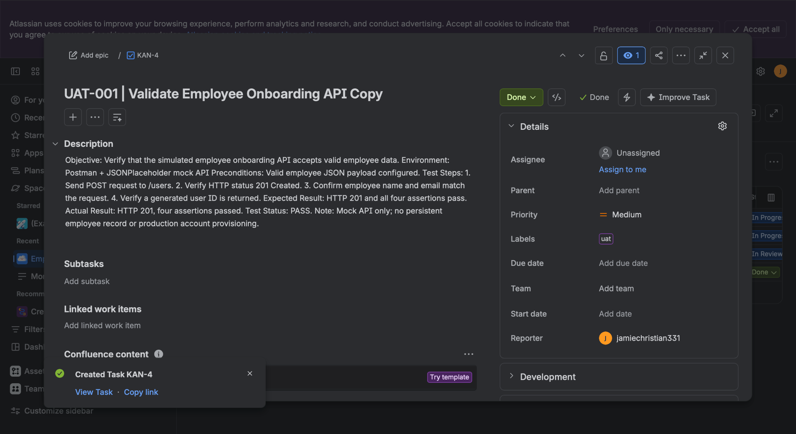
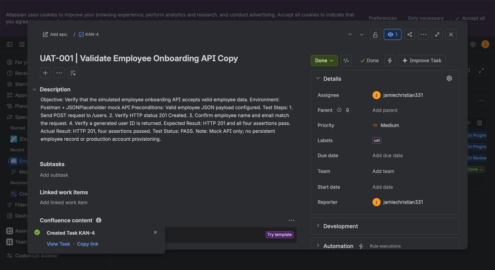
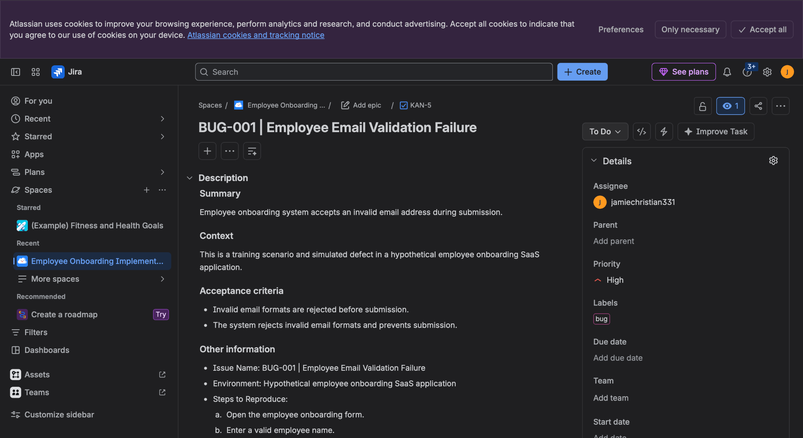
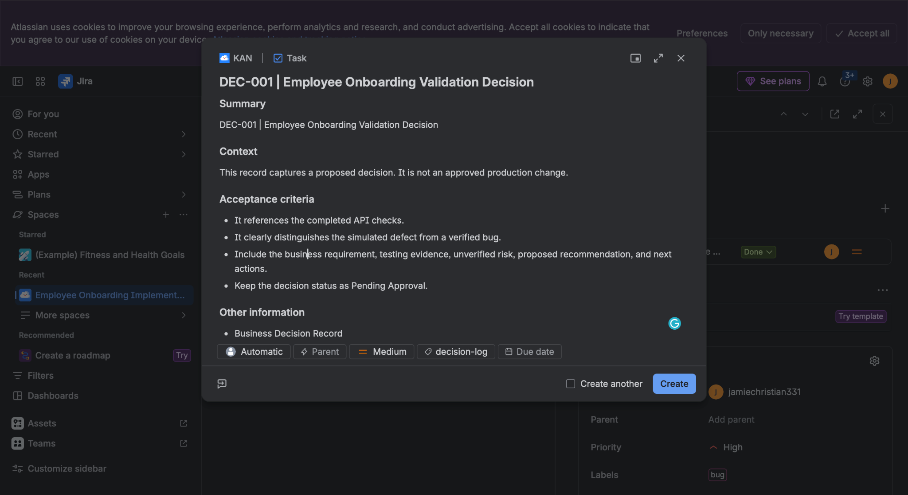

# 🚀 Employee Onboarding SaaS Implementation
### Business Analysis | Systems Integration | API Testing | UAT | Implementation


**📅 Project Date:** October 15, 2026  
**👤 Role:** Business Analyst / Systems Analyst / Implementation Analyst  
**🏢 Environment:** Hypothetical Employee Onboarding SaaS Platform  
**🧰 Tools:** Lucidchart, Postman, Jira, REST APIs, JSON, GitHub

---

## 📌 Executive Summary

This portfolio project demonstrates an end-to-end business and systems analysis exercise focused on improving an organization's employee onboarding process.

The project examines a manual onboarding workflow and develops a proposed SaaS-enabled future state to improve data accuracy, approval management, access provisioning, and operational visibility.

The case study covers:

- 🗺️ Business process discovery and AS-IS/TO-BE mapping
- 📝 Business and functional requirements
- 🔌 REST API integration analysis
- 🧪 Postman API testing and response validation
- 🐞 Jira UAT and defect tracking
- 📊 Gap analysis and process improvement
- 🔐 Proposed security and access controls
- 🚀 Implementation planning and readiness
- 📋 Business decision governance

**Project outcome:** Produced process maps, requirements, API testing evidence, UAT documentation, defect records, and implementation planning artifacts.

This is a training and simulation project, not a deployed production implementation.

---

## 🎯 1. Business Problem

### Current-State Challenges

The hypothetical organization uses a manual employee onboarding process involving Human Resources, Hiring Managers, and IT Support.

Identified process risks include:

- Manual employee information entry
- Repeated data entry across systems
- Email-based manager approvals
- Incomplete or inconsistent employee records
- Delays in account provisioning
- Limited visibility into onboarding status
- Unclear ownership of exceptions
- Inconsistent input validation

### Proposed Business Objectives

| Objective | Proposed Improvement |
|---|---|
| Data accuracy | Validate employee information before submission |
| Process efficiency | Reduce repetitive manual handoffs |
| Approval governance | Introduce documented manager approvals |
| Access management | Standardize IT provisioning requests |
| Operational visibility | Track onboarding status and exceptions |
| Compliance readiness | Maintain auditable decisions and approvals |

---

## 🗺️ 2. Business Process Mapping — Lucidchart

### 🔴 AS-IS: Manual Employee Onboarding



**Process participants:**

- Human Resources
- Hiring Manager
- IT Department

**Current workflow:**

1. Candidate accepts the employment offer.
2. HR manually enters employee information.
3. HR emails the Hiring Manager.
4. Hiring Manager reviews the information.
5. Incomplete records return to HR for correction.
6. Approved records are forwarded to IT.
7. IT manually creates required accounts.
8. Hiring Manager confirms access readiness.
9. The onboarding process closes.

### 🟢 TO-BE: Proposed Automated Employee Onboarding



**Proposed future-state capabilities:**

- Structured employee intake
- Required-field validation
- Duplicate record checks
- Manager approval workflow
- API integration orchestration
- Microsoft Entra ID and Microsoft 365 provisioning design
- Automated status notifications
- Exception logging and retry handling
- Access verification
- Onboarding closure

### 📊 AS-IS vs. TO-BE Comparison

| Business Area | AS-IS | Proposed TO-BE |
|---|---|---|
| Employee intake | Manual spreadsheet | Structured digital form |
| Data validation | Manual review | Automated validation rules |
| Approvals | Email communication | Workflow-based approval |
| Account creation | Manual IT provisioning | Integration-based provisioning |
| Error handling | Email corrections | Exception management workflow |
| Tracking | Manual follow-ups | Centralized status tracking |
| Auditability | Limited records | Documented approval history |

---

## 📝 3. Business and Functional Requirements

### Business Requirements

**BR-001 — Employee Data Accuracy**

The proposed system shall support accurate collection and validation of required employee information.

**BR-002 — Approval Management**

The onboarding workflow shall require an authorized Hiring Manager to approve eligible requests before provisioning.

**BR-003 — Access Provisioning**

Approved onboarding requests shall initiate an authorized IT access provisioning workflow.

**BR-004 — Operational Visibility**

Authorized stakeholders shall be able to view onboarding progress and exceptions.

**BR-005 — Auditability**

The system shall maintain records of approval decisions, relevant changes, and provisioning outcomes.

### Functional Requirements

| ID | Requirement | Priority |
|---|---|---|
| FR-001 | Capture employee onboarding information | High |
| FR-002 | Validate required employee fields | High |
| FR-003 | Validate employee email format | High |
| FR-004 | Route requests for manager approval | High |
| FR-005 | Send approved requests to the integration layer | High |
| FR-006 | Record provisioning outcomes | High |
| FR-007 | Notify relevant stakeholders | Medium |
| FR-008 | Log and route integration exceptions | High |
| FR-009 | Support onboarding status tracking | Medium |
| FR-010 | Maintain an auditable approval history | High |

These are proposed requirements for the hypothetical system, not verified production capabilities.

---

## 🔌 4. REST API Testing — Postman

### Testing Environment

**API Provider:** JSONPlaceholder

**Base URL:** `https://jsonplaceholder.typicode.com`

**Purpose:** Explore HTTP requests, JSON payloads, response validation, and basic API testing.

### 🟢 GET Request — Retrieve Users

**Endpoint:** `GET /users`

**Observed result:** HTTP 200 OK



The request successfully retrieved sample user records.

### 🟢 POST Request — Create Simulated Employee

**Endpoint:** `POST /users`

**Observed result:** HTTP 201 Created



**Example request body:**

```json
{
  "name": "Jordan Smith",
  "username": "jsmith",
  "email": "jordan.smith@example.com",
  "department": "Information Technology",
  "role": "Business Analyst"
}
```

The mock service returned the submitted information and a generated identifier.

### ✅ Postman Automated Assertions



| Test | Result |
|---|---|
| HTTP status equals 201 | ✅ Passed |
| Employee name matches request | ✅ Passed |
| Employee email matches request | ✅ Passed |
| Employee ID exists | ✅ Passed |

**Observed result: 4/4 assertions passed.**

### 💻 Postman Test Scripts



```javascript
pm.test("Status code is 201", function () {
    pm.response.to.have.status(201);
});

pm.test("Employee name matches request", function () {
    const response = pm.response.json();
    pm.expect(response.name).to.eql("Jordan Smith");
});

pm.test("Employee email matches request", function () {
    const response = pm.response.json();
    pm.expect(response.email).to.eql("jordan.smith@example.com");
});

pm.test("Employee ID is returned", function () {
    const response = pm.response.json();
    pm.expect(response.id).to.exist;
});
```

**Testing limitation:** JSONPlaceholder is a mock API. A successful POST response does not prove that an employee was permanently created, that input validation was enforced, or that real account provisioning occurred.

---

## 🧪 5. User Acceptance Testing — Jira

### UAT-001: Validate Employee Onboarding API

**Jira Issue:** KAN-4

**Test objective:** Verify that a valid employee payload receives the expected mock API response.

**Test steps:**

1. Configure the employee JSON payload.
2. Submit the POST request.
3. Verify HTTP status 201.
4. Confirm employee name and email.
5. Verify a generated user ID.
6. Review automated assertion results.

**Expected result:** HTTP 201 and all four assertions pass.

**Actual result:** HTTP 201 and four passing assertions.

**Status:** PASS — Positive mock API test.





---

## 🐞 6. Defect Management — Jira

### BUG-001: Employee Email Validation Failure

**Jira Issue:** KAN-5

**Priority:** High

**Scenario:** A hypothetical employee onboarding application accepts an invalid email address.

**Expected behavior:**

- Invalid email formats are rejected.
- Users receive a meaningful validation message.
- Invalid submissions do not proceed to provisioning.

**Proposed resolution:**

1. Define approved email validation rules.
2. Implement server-side validation.
3. Add negative test scenarios.
4. Verify rejected submissions.
5. Retest after implementation.



**Important:** This is a simulated defect created for business analysis and Jira practice. It is not a verified defect in a live employee onboarding application.

---

## 📋 7. Business Decision Governance

### DEC-001: Employee Onboarding Validation Decision

**Decision:** Proposed mandatory input validation before employee onboarding submission.

**Status:** Pending Approval

**Business justification:**

Invalid employee information could create downstream provisioning errors, manual rework, and data-quality issues.

**Proposed recommendation:**

- Validate mandatory employee fields.
- Validate email format on the server.
- Reject invalid requests before integration.
- Record validation failures.
- Expand negative UAT coverage.



The decision is a proposed control, not an approved production change.

---

## 🚀 8. Implementation Planning

### Proposed Implementation Phases

| Phase | Activities | Deliverables |
|---|---|---|
| 1. Discovery | Stakeholder analysis and process review | AS-IS process map |
| 2. Requirements | BRD, FRD, stories and acceptance criteria | Requirements baseline |
| 3. Solution Design | TO-BE workflow and integration design | Proposed solution architecture |
| 4. Validation | API exploration, test planning and UAT | Test cases and evidence |
| 5. Governance | Risk review and decision management | RAID and decision records |
| 6. Readiness | Training, rollback and support preparation | Implementation checklist |
| 7. Release | Controlled deployment and monitoring | Proposed go-live process |

These phases describe an implementation approach rather than completed production deployment.

---

## 📊 9. Proposed Success Metrics

| KPI | Target |
|---|---|
| Required-field completeness | ≥98% |
| Standard onboarding requests within SLA | ≥95% |
| High-risk access approvals recorded | 100% |
| Critical defects open at go-live | 0 |
| Integration errors logged with an owner | 100% |
| UAT acceptance | Documented approval required |

**Metric status:** Targets only. No production baseline or post-implementation results were measured.

---

## 📂 10. Project Repository Structure

| Folder | Contents |
|---|---|
| [📸 00_Evidence](00_Evidence/) | Screenshots, process maps and evidence register |
| [🗺️ 01_Discovery_and_Process](01_Discovery_and_Process/) | AS-IS/TO-BE process documentation |
| [📝 02_Requirements](02_Requirements/) | Business and functional requirements |
| [🔗 03_Architecture_and_Integration](03_Architecture_and_Integration/) | API contracts, field mappings and integration design |
| [🧪 04_API_Testing](04_API_Testing/) | Postman collection and API test documentation |
| [🐞 05_UAT_and_Defects](05_UAT_and_Defects/) | UAT test cases and Jira defect traceability |
| [🚀 06_Implementation_and_Change](06_Implementation_and_Change/) | Rollout and change management planning |
| [📊 07_Governance](07_Governance/) | RAID, KPIs and decision records |

---

## 💼 11. Professional Skills Demonstrated

### 📊 Business Analysis

- Business process mapping
- Requirements elicitation and documentation
- Gap analysis
- Stakeholder workflow analysis
- Acceptance criteria
- Business process improvement

### 💻 Systems Analysis

- REST API request/response analysis
- JSON payload review
- Data mapping
- Integration requirements
- Validation rules
- Exception handling design

### 🧪 Quality Assurance and UAT

- Positive API testing
- Postman assertions
- Test case documentation
- Jira issue tracking
- Defect simulation
- Requirements traceability

### 🚀 Implementation and Project Coordination

- Implementation planning
- Change management
- Risk identification
- Decision governance
- Release readiness
- Support handoff planning

---

## 🎤 12. Interview-Ready Project Explanation

> I completed a hands-on business and systems analysis case study focused on employee onboarding SaaS implementation. I mapped the manual AS-IS process in Lucidchart, designed a proposed automated TO-BE workflow, documented business and functional requirements, and tested REST API requests using Postman.
>
> My mock API testing produced HTTP 200 and 201 responses, with four automated assertions passing. I documented the positive UAT result in Jira, created a simulated email validation defect, and prepared a proposed business decision record.
>
> The project demonstrates how I approach process discovery, requirements, integration analysis, testing, issue tracking, and implementation readiness while clearly distinguishing tested behavior from proposed functionality.

---

## 🔒 Evidence and Data Integrity

This repository represents an independent training project.

- No production employee accounts were provisioned.
- No real employee onboarding system was modified.
- API testing used the JSONPlaceholder mock service.
- Negative email-validation behavior was simulated.
- Future-state architecture and implementation controls are proposed.
- Screenshots should be reviewed for personal information and sensitive identifiers before public distribution.

---

### ⭐ Project Highlights

**🗺️ 2 Process Maps | 🔌 2 HTTP Request Types | ✅ 4 Passing Assertions | 🐞 1 Simulated Defect | 📋 1 Proposed Decision Record**

**Project focus:** Business Analysis · Systems Analysis · SaaS Implementation · API Testing · UAT · Process Improvement

[⬆️ Back to Business Analyst Portfolio](../README.md)
