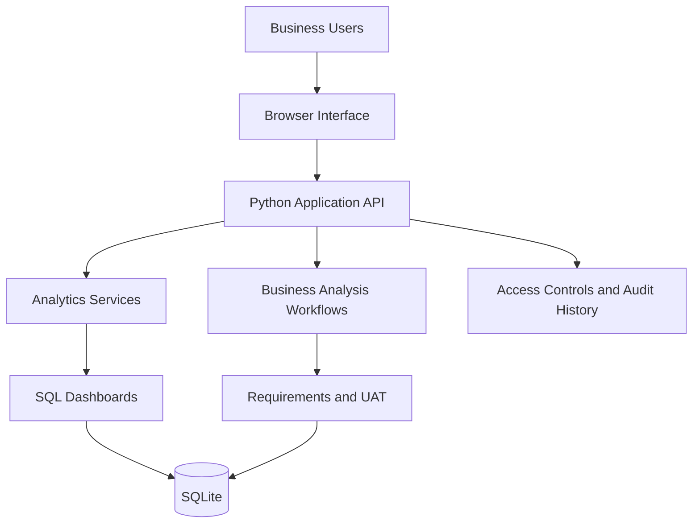
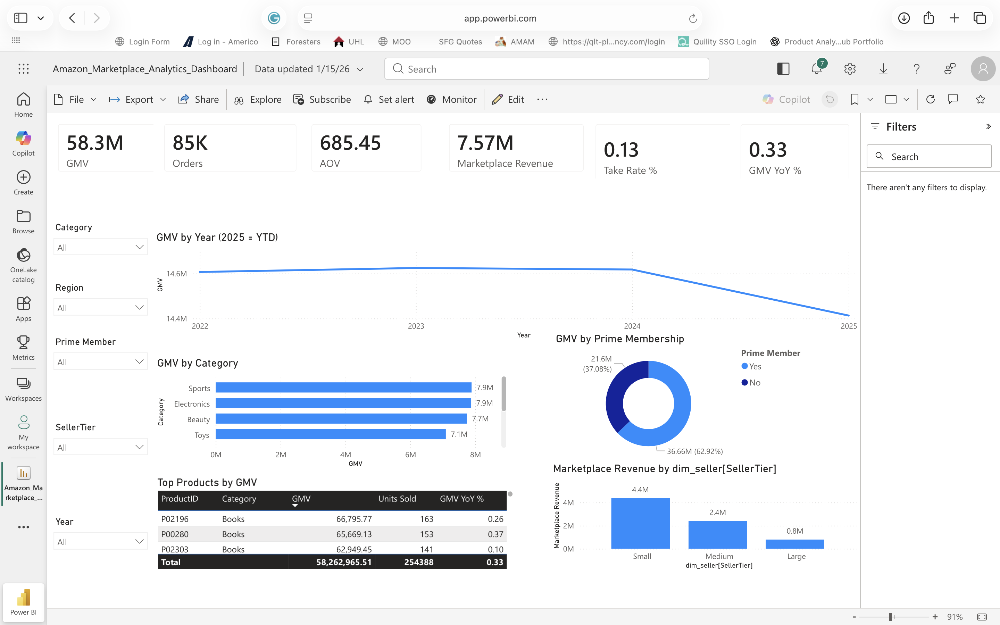
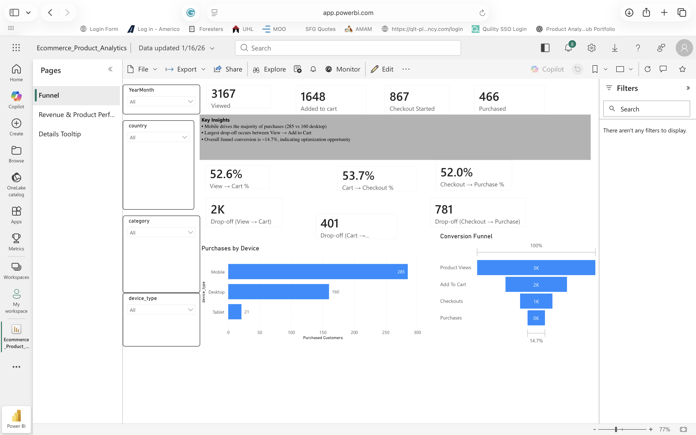
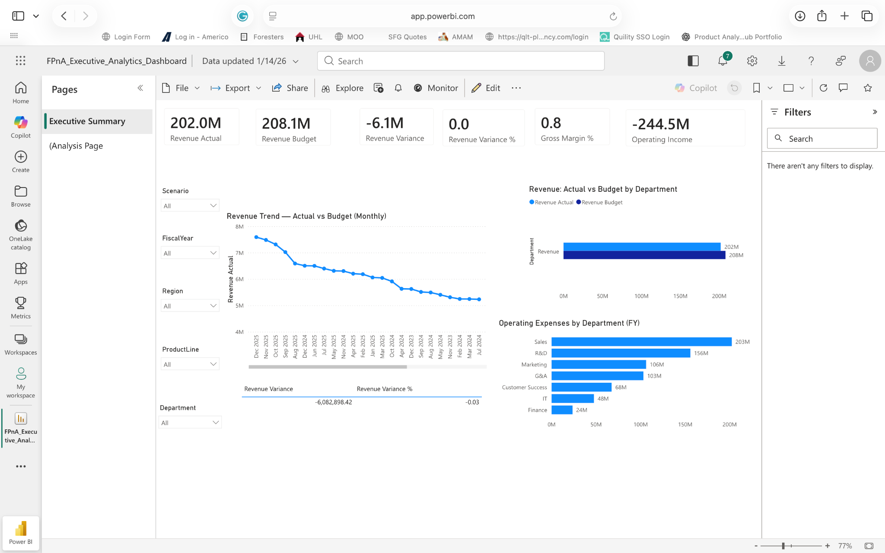
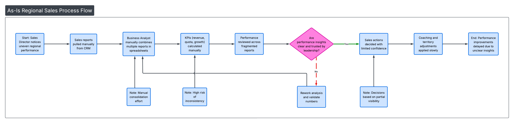
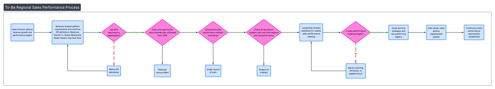
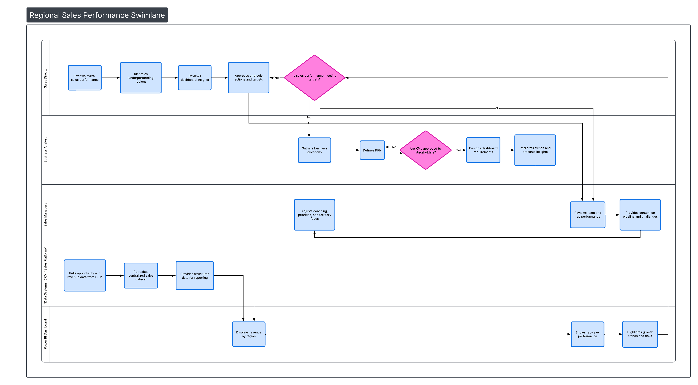
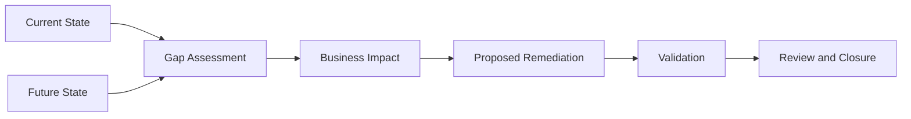
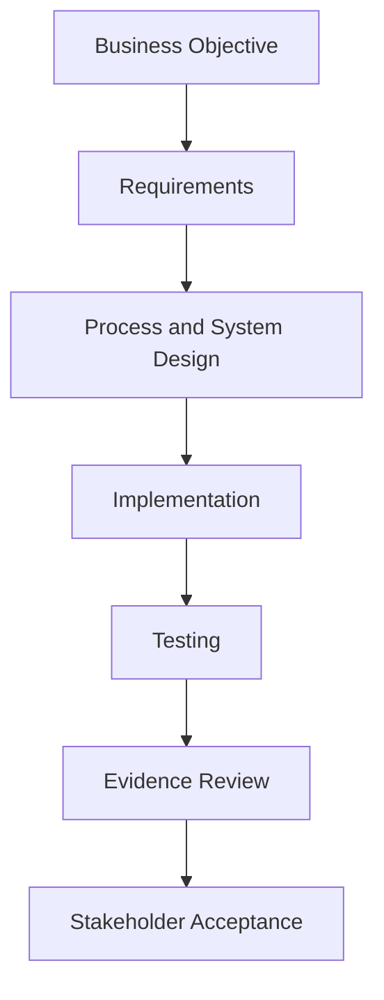

# 📊 Business Analyst & Business Systems Analyst Portfolio

<div align="center">

## 🚀 Turning Business Problems Into Requirements, Analytics & Technology Solutions

**Jamie Christian**


### 🛠️ Technologies & Platforms


[](https://www.linkedin.com/in/jamiechristian2/)
[](https://github.com/JamieChristian22)

</div>

---

## 👋 Executive Portfolio Overview

Welcome to my **Business Analyst and Business Systems Analyst Portfolio**.

This repository showcases hands-on projects that demonstrate how I approach business challenges through requirements engineering, stakeholder analysis, business process modeling, data analytics, system integration, API testing, user acceptance testing (UAT), and implementation planning.

My work focuses on translating business needs into **documented requirements, measurable KPIs, improved workflows, validated technical solutions, and actionable recommendations**.

The portfolio includes cross-industry analytical case studies, a locally implemented Python/SQLite application, and a SaaS employee onboarding implementation case study supported by Lucidchart, Postman, and Jira evidence.

### 🏆 Portfolio at a Glance

| 📌 Portfolio Component | Coverage |
|---|---|
| 📁 Business & Implementation Case Studies | **7** |
| 📊 Analytics-Focused Case Studies | **6** |
| 🔌 SaaS Implementation Case Studies | **1** |
| 📋 Analytics Portfolio Requirements | **48 tracked** |
| 🧪 Analytics Portfolio UAT Cases | **144 planned** |
| 🔍 Analytics Portfolio Gap Records | **48** |
| 💻 Working Local Python/SQLite Application | **1** |
| 📈 SQL-Backed Dashboard Views | **6** |
| 👥 Application Access Roles | **4** |
| ✅ Employee Onboarding API Assertions | **4/4 passed** |
| 🗺️ Employee Onboarding Process Maps | **2** |

> **📌 Portfolio Transparency:** Projects include local implementations, analytical case studies, mock API testing, and proposed system designs. Simulated data, planned tests, production capabilities, and verified execution evidence are distinguished throughout.

---

## 🧭 Quick Navigation

- [🚀 Featured SaaS Implementation](#-featured-saas-implementation-project)
- [💻 Working Business Analysis System](#-working-business-analysis-system)
- [📁 Business Analysis Project Gallery](#-business-analysis-project-gallery)
- [📊 Analytics & Dashboards](#-analytics--dashboards)
- [📐 Business Process Modeling](#-business-process-modeling)
- [📋 Requirements Engineering](#-requirements-engineering--traceability)
- [🧪 API Testing, UAT & Defects](#-api-testing-uat--defects)
- [📊 Corporate Delivery Management](#-corporate-delivery-management)
- [🛠️ Technology Stack](#-technology-stack)
- [👤 About Me](#-about-me)

---

# 🚀 Featured SaaS Implementation Project

<div align="center">

## 🏢 Employee Onboarding SaaS Implementation


**Business Analyst | Systems Analyst | Implementation Analyst**

[📂 View Full Implementation Case Study](./Employee_Onboarding_SaaS_Implementation)

</div>

### 🎯 Business Challenge

A hypothetical organization relies on manual employee onboarding processes involving spreadsheets, email approvals, and manually provisioned IT accounts.

This workflow creates risks involving incomplete information, approval delays, manual rework, and limited operational visibility.

### 🛠️ Hands-On Activities

- Developed an AS-IS employee onboarding process map using Lucidchart.
- Designed a proposed TO-BE workflow with validation, approval routing, API integration, and exception handling.
- Executed GET and POST requests using Postman.
- Inspected JSON request payloads and API responses.
- Created automated Postman response assertions.
- Documented successful UAT results in Jira.
- Created a simulated email-validation defect.
- Linked the simulated defect to its related UAT ticket.
- Prepared business decision and implementation documentation.

### 🗺️ AS-IS — Manual Employee Onboarding


**Current-state scenario:** HR information entry, manager approvals, email handoffs, and manual IT provisioning.

### 🟢 TO-BE — Proposed Automated Onboarding


**Future-state design:** Structured employee intake, validation, manager approval, secure API orchestration, identity provisioning, exception routing, and auditability.

### 🔌 Postman API Testing Results

| Test | Observed Result |
|---|---|
| GET `/users` | ✅ HTTP 200 OK |
| POST `/users` | ✅ HTTP 201 Created |
| HTTP response validation | ✅ Passed |
| Employee name assertion | ✅ Passed |
| Employee email assertion | ✅ Passed |
| Generated ID assertion | ✅ Passed |
| Automated assertion total | **4/4 Passed** |


### 🐞 Jira UAT & Defect Tracking

| Jira Item | Deliverable | Status |
|---|---|---|
| KAN-4 / UAT-001 | Mock employee API validation | ✅ Completed |
| KAN-5 / BUG-001 | Simulated invalid email defect | 📋 Documented |
| KAN-5 ↔ KAN-4 | Related issue traceability | ✅ Linked |
| DEC-001 | Proposed email validation business decision | ⏳ Pending approval |


**Evidence integrity:** API testing used JSONPlaceholder, a mock REST API. The email-validation defect was simulated; no production employee provisioning was performed.

### 💼 Skills Demonstrated

**Business Analysis:** Requirements, process mapping, gap analysis, business decisions.

**Systems Analysis:** REST APIs, JSON, data validation, integration analysis.

**Implementation Analysis:** SaaS workflows, UAT, Jira, defect management, implementation planning.

### 🔗 Project Resources

**[📂 Full Case Study](./Employee_Onboarding_SaaS_Implementation)** · **[📸 Screenshots](./Employee_Onboarding_SaaS_Implementation/00_Evidence/Actual_Exports)** · **[🔌 API Testing](./Employee_Onboarding_SaaS_Implementation/04_API_Testing)** · **[🧪 UAT & Defects](./Employee_Onboarding_SaaS_Implementation/05_UAT_and_Defects)**

---

# 💻 Working Business Analysis System


## 🏗️ From Business Requirements to Working Software

This repository includes a locally implemented Python/SQLite application connecting business analytics, KPI reporting, requirements management, UAT tracking, and structured gap analysis.

### ⚙️ Application Capabilities

| Capability | Function |
|---|---|
| 📊 Six SQL-Backed Dashboards | Business performance reporting |
| 🔎 Interactive Filtering | KPI exploration |
| 📂 Source Data Drilldown | Analytical investigation |
| 📋 Requirements Management | Requirement tracking |
| 🧪 UAT Management | Acceptance testing records |
| 🔍 Gap Management | Process gap tracking |
| 👥 Role-Based Access | Viewer, Analyst, Reviewer, Administrator |
| 🛡️ Audit History | Workflow activity records |
| 🔄 Data Refresh | Staged validation and replacement |
| 💾 Persistent Storage | SQLite database |

### 🏛️ Application Architecture



### ▶️ Run the Application Locally

**Requirements:** Python 3.10+ and SQLite 3.25+.

```bash
git clone https://github.com/JamieChristian22/business-analyst-portfolio.git
cd business-analyst-portfolio
python3 Local_System/server.py
```

Open `http://127.0.0.1:8765`.

### 🧪 Run Integration Tests

```bash
python3 Local_System/test_system.py
```

**[💻 Application](./Local_System)** · **[📐 Architecture](./Local_System/ARCHITECTURE.md)** · **[📘 Documentation](./Local_System/README.md)**

**Deployment scope:** Local working implementation; not a hosted enterprise production system.

---

# 📁 Business Analysis Project Gallery

This portfolio covers business analysis across sales, ecommerce, marketplace operations, finance, marketing, CRM, and SaaS implementation.

| # | Project | Industry / Function | Featured Skills |
|---|---|---|---|
| 01 | [📈 Regional Sales Performance](./Regional_Sales_Performance_Project) | Sales Operations | KPI analysis, SQL, process improvement |
| 02 | [🛍️ Ecommerce Product Analytics](./Ecommerce_Product_Analytics_Project) | Digital Commerce | Conversion analysis, requirements |
| 03 | [🛒 Amazon Marketplace Analytics](./Amazon_Marketplace_Analytics_Project) | Marketplace Operations | Margin analysis, reporting |
| 04 | [💰 FP&A Executive Analytics](./FPnA_Executive_Analytics_Project) | Corporate Finance | Budget variance, forecasting |
| 05 | [📣 Marketing Performance & ROI](./Marketing_Performance_ROI_Project) | Marketing Operations | Campaign ROI, acquisition metrics |
| 06 | [☁️ Salesforce Pipeline Analytics](./Salesforce_Project) | CRM / Sales Operations | Pipeline reporting, forecasting |
| 07 | [🚀 Employee Onboarding SaaS](./Employee_Onboarding_SaaS_Implementation) | HR / IT Implementation | Process maps, APIs, UAT, Jira |

## 📈 01 — Regional Sales Performance

**Business challenge:** Improve sales leadership visibility into regional performance, product profitability, and target attainment.

**Deliverables:** KPI requirements, Excel and SQL analysis, dashboards, process models, and business recommendations.

**Success measures:** Revenue variance, target attainment, gross margin, reporting turnaround time.

[🔗 Explore Regional Sales Project](./Regional_Sales_Performance_Project)

## 🛍️ 02 — Ecommerce Product Analytics

**Business challenge:** Identify conversion friction and evaluate customer purchasing behavior.

**Deliverables:** Customer journey analysis, product performance reporting, funnel metrics, process maps, and requirements documentation.

**Success measures:** Conversion, cart abandonment, revenue per visitor, checkout completion.

[🔗 Explore Ecommerce Project](./Ecommerce_Product_Analytics_Project)

## 🛒 03 — Amazon Marketplace Analytics

**Business challenge:** Improve seller, product, pricing, and profitability reporting.

**Deliverables:** Seller analysis, category revenue reporting, gross margin analysis, SQL, Excel, and supporting diagrams.

**Success measures:** Gross margin, seller contribution, revenue by category, pricing variance.

[🔗 Explore Amazon Marketplace Project](./Amazon_Marketplace_Analytics_Project)

## 💰 04 — FP&A Executive Analytics

**Business challenge:** Support finance leadership with reliable forecasting and variance reporting.

**Deliverables:** Budget-versus-actual analysis, scenario models, executive dashboards, and business documentation.

**Success measures:** Forecast accuracy, expense variance, budget variance, reporting cycle time.

[🔗 Explore FP&A Project](./FPnA_Executive_Analytics_Project)

## 📣 05 — Marketing Performance & ROI

**Business challenge:** Evaluate campaign effectiveness, customer acquisition costs, and channel performance.

**Deliverables:** Campaign analysis, ROI reporting, SQL and Excel analytics, process documentation, and management recommendations.

**Success measures:** Marketing ROI, acquisition cost, conversion, channel contribution.

[🔗 Explore Marketing ROI Project](./Marketing_Performance_ROI_Project)

## ☁️ 06 — Salesforce Sales Pipeline Analytics

**Business challenge:** Improve CRM reporting, opportunity-stage consistency, and pipeline forecasting.

### 📊 Sample Dataset Results

| KPI | Portfolio Dataset Value |
|---|---:|
| Total Pipeline | $164,000 |
| Weighted Pipeline | $83,550 |
| Average Deal Size | $16,400 |
| Proposal-Stage Pipeline | $67,000 |
| Closed-Lost Value | $15,000 |

**Deliverables:** Pipeline analysis, sales KPI calculations, CRM reporting, and business recommendations.

*These figures represent portfolio sample data, not verified production results.*

[🔗 Explore Salesforce Project](./Salesforce_Project)

---

# 📊 Analytics & Dashboards

The portfolio demonstrates data-driven decision support across multiple business functions.

<table>
<tr>
<td width="50%">

**🛒 Amazon Marketplace**



</td>
<td width="50%">

**🛍️ Ecommerce Analytics**



</td>
</tr>
<tr>
<td width="50%">

**💰 FP&A Executive Analytics**



</td>
<td width="50%">

**📣 Marketing ROI**


</td>
</tr>
</table>

### 📈 Analytical Skills

- SQL queries and aggregations
- Microsoft Excel reporting
- Data validation and reconciliation
- KPI definition and reporting
- Financial variance analysis
- Revenue and profitability analysis
- Executive dashboard development
- Business recommendations

---

# 📐 Business Process Modeling


Business process mapping is used to identify inefficiencies, clarify responsibilities, document process flows, and design improvements.

### 📊 Regional Sales — AS-IS Process



### 🟢 Regional Sales — TO-BE Process



### 🏊 Cross-Functional Swimlane



### 🔍 Gap Analysis Lifecycle



**[📋 View Gap Register](./Delivery/Portfolio_Gap_Register.csv)**

---

# 📋 Requirements Engineering & Traceability


### 📝 Core Deliverables

| Artifact | Purpose |
|---|---|
| 📘 Business Requirements Document | Business objectives and scope |
| 📗 Functional Requirements Document | System behavior and business rules |
| 🔗 Requirements Traceability Matrix | Requirements-to-testing relationships |
| 📝 User Stories | User needs and functional outcomes |
| ✅ Acceptance Criteria | Testable conditions |
| 🧪 UAT Test Cases | Expected versus actual behavior |
| 🔍 Gap Register | Current-state and target-state differences |
| ⚠️ RAID Log | Risks, assumptions, issues, dependencies |
| 📋 Decision Log | Proposed and approved decisions |

### 🔄 Requirements Lifecycle



---

# 🧪 API Testing, UAT & Defects

### 🔌 API Testing

**Tools:** Postman, REST, HTTP, JSON

Testing practice includes:

- GET and POST requests
- JSON request and response inspection
- Status code assertions
- Field value verification
- API response testing
- Positive test documentation

### 🐞 UAT & Issue Management

**Tool:** Jira

Hands-on activities include:

- UAT work item creation
- Defect reporting
- Priority assignment
- Issue status management
- Defect-to-test traceability
- Business decision recording

**Featured evidence:** [Employee Onboarding API & Jira Case Study](./Employee_Onboarding_SaaS_Implementation)

### 🛡️ Testing Integrity

The Employee Onboarding project uses a mock API. Its successful positive assertions do not demonstrate real employee provisioning. Defect scenarios and unexecuted negative cases are labeled accordingly.

---

# 📊 Corporate Delivery Management


The portfolio includes a centralized Excel delivery workbook for business analysis governance.

| Worksheet | Function |
|---|---|
| 📊 Dashboard | Portfolio status reporting |
| 📋 Requirements | Requirement management |
| 🧪 UAT | Acceptance test planning |
| 🔍 Gap Analysis | Gap tracking |
| ⚠️ RAID | Risk and dependency management |
| 🐛 Defects | Defect records |
| 🔄 Change Control | Change requests |
| 📘 Guidance | Workbook operating instructions |

**[📥 Corporate Delivery Workbook](./Delivery/Portfolio_Delivery_Tracker.xlsx)** · **[📖 Workbook Guide](./Delivery/CORPORATE_WORKBOOK_GUIDE.md)**

---

# 🛠️ Technology Stack

| Category | Tools & Technologies |
|---|---|
| 📊 Analytics | SQL, Microsoft Excel |
| 📈 BI & Reporting | Power BI, KPI dashboards |
| 💻 Programming | Python, JavaScript, HTML |
| 🗃️ Databases | SQLite |
| 🗺️ Process Modeling | Lucidchart, diagrams.net |
| 🔌 API Testing | Postman, REST, JSON |
| 📋 Work Management | Jira |
| 📝 Documentation | BRD, FRD, RTM, user stories |
| 🧪 Quality Assurance | UAT, assertions, integration tests |
| 🚀 Implementation | SaaS workflows, gap analysis, rollout planning |
| 🛡️ Governance | RAID, change control, decision logs |
| 🔧 Version Control | Git, GitHub |

---

# 📂 Repository Structure

```text
business-analyst-portfolio/
│
├── 🚀 Employee_Onboarding_SaaS_Implementation/
├── 📈 Regional_Sales_Performance_Project/
├── 🛍️ Ecommerce_Product_Analytics_Project/
├── 🛒 Amazon_Marketplace_Analytics_Project/
├── 💰 FPnA_Executive_Analytics_Project/
├── 📣 Marketing_Performance_ROI_Project/
├── ☁️ Salesforce_Project/
│
├── 📊 Delivery/
├── 💻 Local_System/
├── 🖼️ Images/
├── 📁 Legacy/
├── ⚙️ scripts/
│
└── 📘 README.md
```

*The emojis above are visual labels; the actual repository folder names do not contain them.*

---

# 🎯 Career Skills & Competencies

| Career Path | Demonstrated Competencies |
|---|---|
| 📊 Business Analyst | Requirements, process mapping, gap analysis, UAT |
| 💻 Business Systems Analyst | System workflows, technical requirements, SQL |
| 🔌 Systems Analyst | API analysis, data mapping, integration design |
| 🚀 Implementation Analyst | SaaS implementation design, Jira, Postman, UAT |
| 🧪 Technical Business Analyst | REST APIs, JSON, testing, traceability |
| 📈 Operations Analyst | KPI reporting, process improvement |
| 📋 Project Coordinator | Tracking, risk documentation, decision logs |

---

# 🚀 Future Development Roadmap

Potential improvements to strengthen production-oriented capability include:

- 🔐 Enterprise authentication and SSO
- ☁️ Secure cloud deployment
- 🔗 Live SaaS and CRM integrations
- 🧪 Expanded API negative testing
- 📊 Automated requirements traceability reports
- 🔄 Integration monitoring and error dashboards
- 🚦 Release readiness and deployment validation
- 📈 Measured before-and-after process improvements

These are proposed future improvements, not claims of completed deployment.

---

# 👤 About Me

**Jamie Christian**

🎓 **Bachelor of Science — Entrepreneurial Management, Cum Laude**  
Virginia Union University

I am a business and technology professional with experience in business operations, client-facing workflows, business analysis, and hands-on technology projects.

My portfolio reflects an interest in connecting business needs with practical technical solutions through process improvement, requirements engineering, data analytics, API testing, and system implementation.

### 🎯 Target Career Paths

Business Analyst · Business Systems Analyst · Technical Business Analyst · Systems Analyst · Implementation Analyst · Operations Analyst

---

<div align="center">

## 🤝 Connect With Me

[](https://www.linkedin.com/in/jamiechristian2/)

[](https://github.com/JamieChristian22)

### 💡 From Business Problems to Measurable, Technology-Enabled Solutions

**Business Analysis • Systems Analysis • SaaS Implementation • SQL • Excel • APIs • UAT**

⭐ Explore the projects to review the supporting documentation, diagrams, testing evidence, and business recommendations.

</div>
